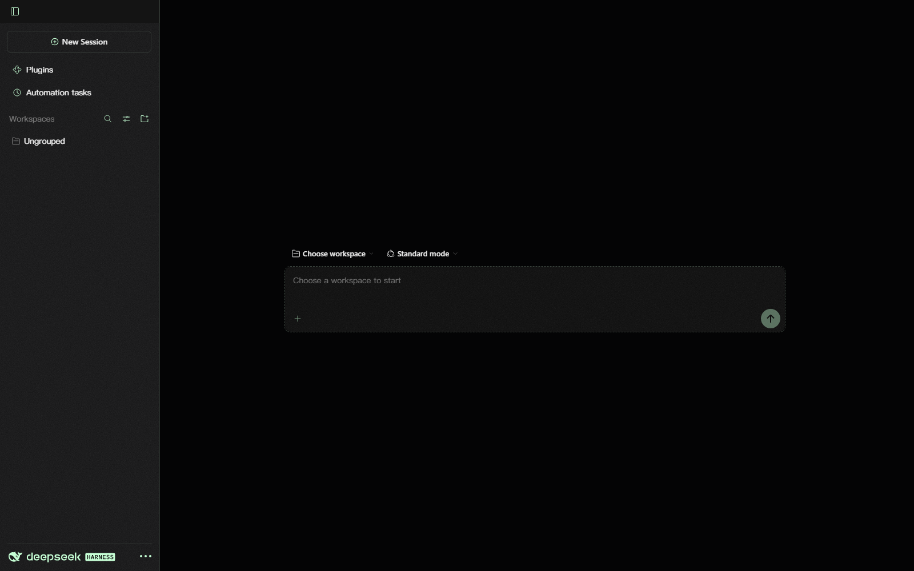

# Matrix · DSH Matrix Theme

A Codex-Matrix dark theme for the **DeepSeek Harness** web GUI. The chrome follows the
Claude-style layout: a flush sidebar, a flat session band, and the Windows caption merged
with the canvas. The sidebar and composer carry the frosted glass.


> The window buttons and title content in the preview are illustrative; DSH supplies the
> live caption controls and session text.

### Account row



## Design

- **Canvas:** flat `#040405`, one solid fill across the page.
- **Accent `#C6FFD5`:** icons, active states, focus rings and the send control.
- **Foreground `#D9FFE2`:** borders, dividers and layout strokes.
- **Text:** neutral grays; the accent stays on icons and controls.
- **Sidebar:** flush with all four window edges, a single foreground hairline on the right,
  and frost from a translucent neutral fill, backdrop blur and fine grain.
- **Composer:** 10px corners, a 1px foreground hairline, frosted grain and backdrop blur;
  the hairline turns to the accent while the field has focus.
- **Title bar:** the Windows 40px caption row uses the canvas fill, with minimize, maximize
  and close sitting directly on the page; the sidebar hairline runs to the top edge, and the
  session header is a flat divided band.
- **Radii:** square sidebar and title band; 10px composer; 8px menus; 4–6px controls.
- **Typography:** follows the text font and size in DSH Settings → General → Appearance.

## Install

### From GitHub (recommended)

```bash
dsh plugin --profile desktop add SShiRkiT/dsh-matrix-theme#main
```

Use `--profile web` for the web profile.

### From a local checkout

```bash
dsh plugin --profile desktop add "D:\path\to\dsh-matrix-theme"
```

### Manual

Copy the package into the profile's `node_modules/dsh-matrix-theme`, then append to
`$DSH_HOME/profiles/<profile>/cordis.patch.yml`:

```yaml
- insert:
    - id: ui-skin-matrix
      name: 'dsh-matrix-theme'
```

Restart DeepSeek Harness after installing; the client-plugin roster is composed at boot.

## Uninstall

Disable or remove the plugin in Settings → Plugins, or delete the package from the profile's
`node_modules` and drop the `ui-skin-matrix` row from `cordis.patch.yml`. The stock styling
returns immediately. The dark preference written by the theme remains and can be changed in
Settings → General → Appearance.

## Compatibility

Developed and verified against **DeepSeek Harness 0.2.1-rc.2**. The theme builds on the
client plugin surface (`ctx.theme.overrideTokens`, `ctx.effect`) and the current DSH DOM
hooks:

- `header` + `[data-slot="conversation.header"]` for the session band
- `[data-composer-card]` for the composer
- `[class$="_sidebarCol"]` for the sidebar
- `[data-phase]` and `[data-conversation-content]` for the conversation root
- `[data-windows-titlebar]` for the Windows caption row

The layout, glass and title bar are implemented against the current DSH DOM. If a future DSH
release changes one of these hooks, update the selectors in `src/matrix.css`;
`scripts/check.mjs` keeps every rule scoped under `html[data-dsh-matrix]` and keeps the
stylesheet flat.

## Development

```bash
node scripts/build.mjs   # inline src/matrix.css into the ModuleLoader factory
node scripts/check.mjs   # parse, scope, typography and gradient checks
```

Layout:

```text
src/matrix.css           # all visual rules, scoped to data-dsh-matrix
src/client.template.js   # browser half: tokens, dark pin, style injection
lib/client.js            # built artifact loaded by DSH
lib/index.js             # empty host half so the package mounts in cordis
scripts/build.mjs        # zero-dependency build
scripts/check.mjs        # static checks
```

`lib/client.js` is a classic script that registers a `__ModuleLoader__.load` factory, the
shape DSH's client module system expects. Rebuild and commit `lib/client.js` after changing
the CSS.

## Credits

Thanks to DeepSeek Harness for the composable client plugin system.

## License

[MIT](LICENSE) © 2026 SShiRkiT
