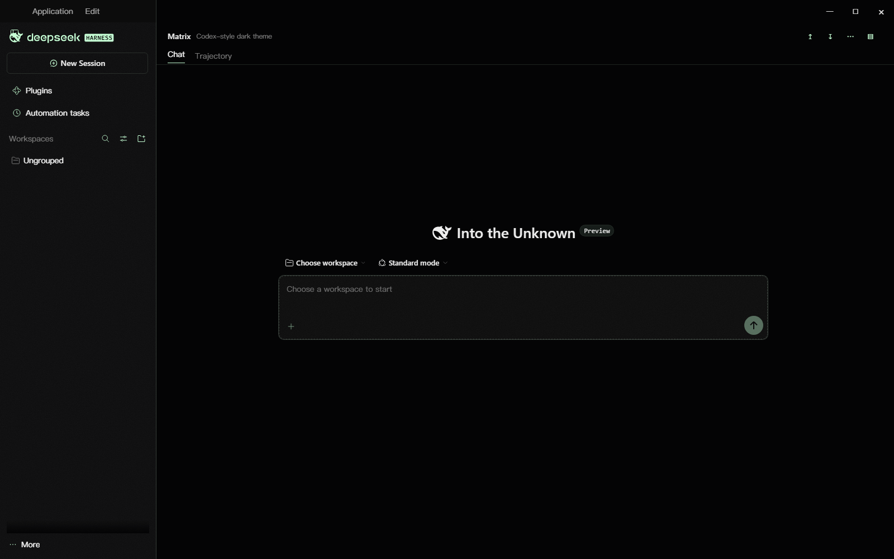

# Matrix · DSH Matrix Theme

为 **DeepSeek Harness** 做的 Codex Matrix 暗色主题。布局采用 Claude-style 的现代 chrome：
侧栏贴边、会话标题区平直、Windows 标题栏与画布连成一体；侧栏和输入框保留一层磨砂玻璃。



> 预览里的窗口按钮与标题内容为示意；实际运行时由 DSH 的窗口控件和会话填充。

## 设计

- **画布**：纯黑 `#040405`，整块平面填充，颜色统一。
- **强调色 `#C6FFD5`**：图标、激活态、焦点环与发送键。
- **前景色 `#D9FFE2`**：边框、分隔线与布局描边。
- **文字**：中性灰阶；强调色留给图标和控件。
- **侧栏**：贴住窗口四边，右侧一条前景色细线；磨砂来自半透明中性填充、背景模糊和细微颗粒。
- **输入框**：10px 圆角、1px 前景色描边、磨砂颗粒与背景模糊；输入时描边转为强调色。
- **标题栏**：Windows 的 40px caption 行沿用画布颜色，最小化、最大化和关闭按钮直接落在页面上；侧栏描边延伸到窗口顶部；会话标题区是一条平直分隔带。
- **圆角**：侧栏与标题区为直角，输入框 10px，菜单 8px，控件 4–6px。
- **字体**：沿用 DSH「设置 → 通用 → 外观」里的正文字体与字号。

## 安装

### 从 GitHub（推荐）

```bash
dsh plugin --profile desktop add SShiRkiT/dsh-matrix-theme#main
```

Web 端 profile 换成 `web`：

```bash
dsh plugin --profile web add SShiRkiT/dsh-matrix-theme#main
```

### 从本地目录

```bash
dsh plugin --profile desktop add "D:\path\to\dsh-matrix-theme"
```

### 手动安装

把整个包复制到 profile 的 `node_modules/dsh-matrix-theme`，然后在
`$DSH_HOME/profiles/<profile>/cordis.patch.yml` 追加：

```yaml
- insert:
    - id: ui-skin-matrix
      name: 'dsh-matrix-theme'
```

安装后**重启** DeepSeek Harness；客户端插件的组合发生在启动时。

## 卸载

在「设置 → 插件」里停用或移除，或从 profile 的 `node_modules` 删除包并去掉
`cordis.patch.yml` 里的 `ui-skin-matrix` 行。原生样式立即恢复；主题写入的深色偏好会保留，
可在「设置 → 通用 → 外观」里改回浅色或跟随系统。

## 兼容性

在 **DeepSeek Harness 0.2.1-rc.2** 上开发与验证。主题通过客户端插件接口
（`ctx.theme.overrideTokens`、`ctx.effect`）和当前 DSH 的稳定 DOM 钩子工作：

- `header` + `[data-slot="conversation.header"]`（会话标题区）
- `[data-composer-card]`（输入框）
- `[class$="_sidebarCol"]`（侧栏）
- `[data-phase]`、`[data-conversation-content]`（会话根与内容区）
- `[data-windows-titlebar]`（Windows caption 行）

布局、玻璃与标题栏按当前 DSH 的 DOM 重新实现。未来的 DSH 版本如果调整这些钩子，同步
`src/matrix.css` 中的选择器即可；`scripts/check.mjs` 会检查所有规则都限定在
`html[data-dsh-matrix]` 下，并检查样式表保持平面填充。

## 开发

```bash
node scripts/build.mjs   # 把 src/matrix.css 内联进 lib/client.js 的 ModuleLoader 工厂
node scripts/check.mjs   # 解析产物、校验作用域/字体/渐变
```

目录：

```text
src/matrix.css           # 全部视觉规则（限定在 data-dsh-matrix）
src/client.template.js   # 浏览器半侧：token 覆盖、深色固定、样式注入
lib/client.js            # 构建产物（DSH 客户端直接加载）
lib/index.js             # 宿主半侧空实现，让包出现在 cordis 树里
scripts/build.mjs        # 零依赖构建
scripts/check.mjs        # 静态检查
```

`lib/client.js` 是 DSH 客户端模块系统要求的 classic script + `__ModuleLoader__.load` 工厂。
修改 CSS 后重新构建并提交新的 `lib/client.js`。

## 致谢

感谢 DeepSeek Harness 提供的可组合客户端插件系统。

## License

[MIT](LICENSE) © 2026 SShiRkiT
